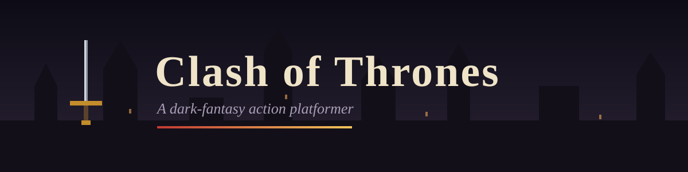
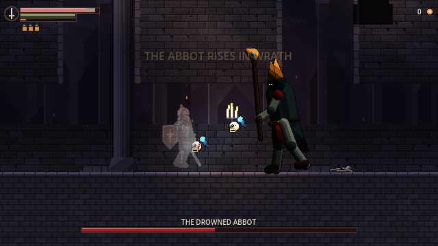
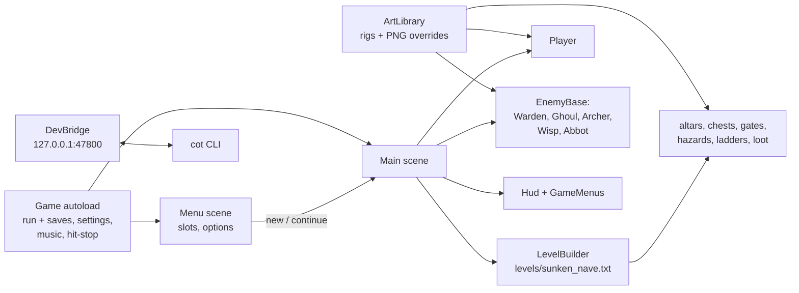

<div align="center">



**A 2D dark-fantasy action platformer: a lone knight, a drowned cathedral, and every swing has weight.**




</div>

---

## ✨ What's in v0.3
| | Feature |
|---|---|
| 🏰 | **One full level, The Sunken Nave**: 7 areas (entrance hall, crumbling pit, warden hall, wall-jump shaft, upper galleries, crypt, boss arena), 3 altars, chests, secrets, a lever gate, a locked reliquary, hazards |
| 🗡️ | **Moves**: walk, run, sprint, variable jump, double jump, wall slide + jump, ledge grab + climb, ladders, drop-through, roll, air dash, plunge attack |
| ⚔️ | **Combat**: 3-hit combo, heavy + charged attack, running and aerial attacks, block, perfect-block parry, shield bash, guard break, executions, **Wrath** mode, healing flasks, stamina |
| 💀 | **Enemies**: Grave Warden (heavy), Ghoul (fast), Bone Archer (ranged, parry its arrows back), Wisp (flying) - they detect, call allies, chase, search and return to patrol |
| 👑 | **Boss: The Drowned Abbot**: two phases, shockwaves, unblockable sweep, summons, fire pillars |
| 📈 | **Souls-like progression**: ashes from enemies, level up Vitality / Strength / Endurance at altars, drop your ashes on death and win them back, relics (2 slots), key items |
| 💾 | **Menus + saves**: title screen, 3 save slots, autosave at altars, pause menu, options (graphics, audio, difficulty, accessibility, controls) |
| 🎨 | Hero and enemies repainted with a local AI pipeline (SDXL + pixel-art LoRA) over code-drawn rigs; world art generated in code |
| 🔌 | DevBridge + `cot` CLI: see, change and test the running game from the terminal |

Full mechanics list (built / later / not for 2D): [docs/MECHANICS_BACKLOG.md](docs/MECHANICS_BACKLOG.md)

## 🎮 Controls
| Action | Keyboard | Gamepad |
|---|---|---|
| Move | A / D | left stick |
| Jump (hold = higher, again in air = double jump, at a wall = wall jump) | Space | A |
| Light attack (combo; while sprinting / in air; down + attack in air = plunge) | J | X |
| Heavy attack (hold to charge) | I | Y |
| Roll (tap) / Sprint (hold) / Air dash | K or Shift | B |
| Block (hold) / Parry (just before the hit) / + J = shield bash | L | LB |
| Drink flask | R | RB |
| Wrath (when the bar is full) | F | RT |
| Interact / execute a staggered enemy | E / J | LT / X |
| Drop through a ledge | S + Space | down + A |
| Pause | Esc | Start |

## 🚀 Quick start
Needs **Godot 4.7.2 .NET** (`winget install GodotEngine.GodotEngine.Mono`) and the **.NET 10 SDK**.
```powershell
.\scripts\run.ps1            # build + play   (-Editor opens the Godot editor)
.\scripts\smoke.ps1          # menu -> new game -> simulated input, headless; fails on any error
.\scripts\shot.ps1           # screenshot into reports\screenshots\
```

## ⬇️ Download the demo (Windows)
Get **ClashOfThrones-v0.3.1-Demo-Setup.exe** from the [Releases page](https://github.com/CodTanium/ClashofThrones/releases) and run it
(installs per user, no admin rights; Start-menu + optional desktop shortcut; uninstall from Windows Settings > Apps).
Windows may warn about an unknown publisher because the demo isn't code-signed yet: **More info → Run anyway**. A plain `.zip` is attached too.

Build it yourself: `.\scripts\installer.ps1` (Inno Setup 6) → `build\ClashOfThrones-v<version>-Demo-Setup.exe`; `.\scripts\package.ps1` → zip only.
Steam: upload files are ready, the account side is pending - see [docs/STEAM.md](docs/STEAM.md) ([#13](https://github.com/CodTanium/ClashofThrones/issues/13)). Apple/mobile: later ([#14](https://github.com/CodTanium/ClashofThrones/issues/14)).

## 🏗️ Architecture

More: [docs/TECHNICAL.md](docs/TECHNICAL.md).

## 📚 Documentation
| I want to... | Go to |
|---|---|
| see where the project stands | [docs/PROJECT_STATUS.md](docs/PROJECT_STATUS.md) · [docs/ROADMAP.md](docs/ROADMAP.md) |
| understand the game | [docs/GAME_DESIGN_DOCUMENT.md](docs/GAME_DESIGN_DOCUMENT.md) · [docs/MECHANICS_BACKLOG.md](docs/MECHANICS_BACKLOG.md) |
| edit the level | [src/levels/sunken_nave.txt](src/levels/sunken_nave.txt) (legend at the top) |
| make art that fits | [docs/ART_DIRECTION.md](docs/ART_DIRECTION.md) |
| check asset licences | [docs/ASSET_LICENCES.md](docs/ASSET_LICENCES.md) |
| see known bugs | [docs/BUG_TRACKER.md](docs/BUG_TRACKER.md) |
| understand the code / DevBridge | [docs/TECHNICAL.md](docs/TECHNICAL.md) |
| continue the work | [work/CONTINUE-HERE.md](work/CONTINUE-HERE.md) |
| see what changed | [CHANGELOG.md](CHANGELOG.md) |

## 🗂️ Layout
`src/` Godot project (C# in `src/scripts/`, level maps in `src/levels/`) · `tools/Cot/` DevBridge CLI · `scripts/` build, smoke, screenshot, run, art
`docs/` design, art, licences, status · `reports/` screenshots, concepts, issue reports · `work/` plan, baseline, handover, GitHub setup

## ⚖️ Originality
Original IP. All characters, art, names, places and sounds are made for this project (generated in code, then refined with local AI tools).
No assets from other games are used.
