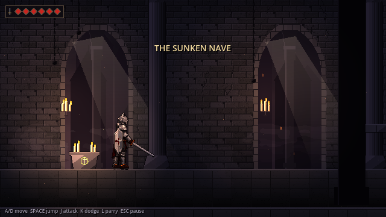
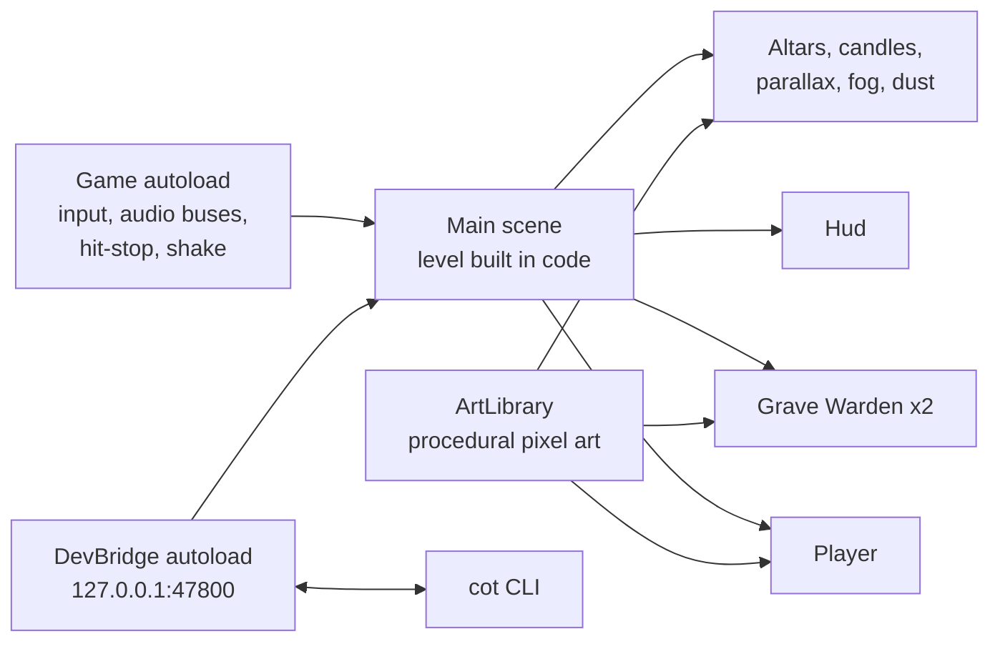

<div align="center">


**A 2D dark-fantasy action platformer: a lone knight, a drowned cathedral, and every swing has weight.**




</div>

---

## ✨ Features
| | Feature | Status |
|---|---|---|
| 🗡️ | Knight: run, variable jump, coyote time, jump buffer, 3-hit combo, dodge with i-frames, shield parry | playable |
| 💀 | Grave Warden: patrols, chases, telegraphs a heavy swing, keeps poise, staggers when parried | playable |
| 🕯️ | Altars: checkpoint, heal, respawn point. Death → fade → respawn, enemies reset | playable |
| 🏰 | Gothic brick dungeon: 5 parallax layers, 2D candle lights, light shafts, fog, dust | playable |
| 💥 | Game feel: hit-stop, screen shake, hit flash, sparks, knockback | playable |
| 🎨 | All art generated in code (original placeholder pixel art), ready to be painted over | placeholder |
| 🔌 | DevBridge + `cot` CLI: see, change and test the running game from the terminal | working |

## 🎮 Controls
| Action | Keyboard | Gamepad |
|---|---|---|
| Move | A / D or ← / → | left stick / d-pad |
| Jump (hold = higher) | Space / Z | A |
| Attack (press again = combo) | J / X / left mouse | X |
| Dodge | K / C / Shift | B / RB |
| Parry (shield, just before a hit) | L / V | LB / Y |
| Pause | Esc | Start |

## 🚀 Quick start
Needs **Godot 4.7.2 .NET** (`winget install GodotEngine.GodotEngine.Mono`) and the **.NET 10 SDK**.
```powershell
.\scripts\run.ps1            # build + play   (-Editor opens the Godot editor)
.\scripts\smoke.ps1          # build + headless run with simulated input; fails on any error
.\scripts\shot.ps1           # screenshot into reports\screenshots\
```
Godot is found through the `GODOT` user environment variable (path to the `..._mono_win64.exe`) or the usual install folders.

## 🏗️ Architecture

More: [docs/TECHNICAL.md](docs/TECHNICAL.md).

## 📚 Documentation
| I want to... | Go to |
|---|---|
| see where the project stands | [docs/PROJECT_STATUS.md](docs/PROJECT_STATUS.md) · [docs/ROADMAP.md](docs/ROADMAP.md) |
| understand the game | [docs/GAME_DESIGN_DOCUMENT.md](docs/GAME_DESIGN_DOCUMENT.md) |
| make art that fits | [docs/ART_DIRECTION.md](docs/ART_DIRECTION.md) |
| check asset licences | [docs/ASSET_LICENCES.md](docs/ASSET_LICENCES.md) |
| see known bugs | [docs/BUG_TRACKER.md](docs/BUG_TRACKER.md) |
| understand the code / DevBridge | [docs/TECHNICAL.md](docs/TECHNICAL.md) |
| continue the work | [work/CONTINUE-HERE.md](work/CONTINUE-HERE.md) |
| see what changed | [CHANGELOG.md](CHANGELOG.md) |

## 🗂️ Layout
`src/` Godot project (C# in `src/scripts/`) · `tools/Cot/` DevBridge CLI · `scripts/` build, smoke, screenshot, run
`docs/` design, art, licences, status · `reports/` screenshots + issue reports · `work/` plan, baseline, handover, GitHub setup

## ⚖️ Originality
Original IP. All characters, art, names, places and sounds are made for this project (currently generated in code).
No assets from other games are used.
