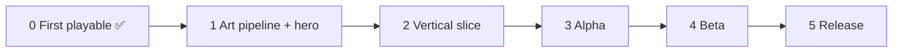

# Roadmap
**What:** the road from first playable to release, phase by phase. **Updated:** 2026-11-21 · current: **Phase 2 (vertical slice polish)**
Status of the current milestone: [PROJECT_STATUS.md](PROJECT_STATUS.md) · design: [GAME_DESIGN_DOCUMENT.md](GAME_DESIGN_DOCUMENT.md)

## Phase 0: First playable ✅ (2026-11-21)
- [x] Godot 4.7.2 .NET project, pixel-perfect 640x360
- [x] Knight: move, variable jump, combo, dodge, parry, hurt, death
- [x] Grave Warden, two altars, death/respawn loop
- [x] Gothic dungeon scene: parallax, candle lights, fog, dust
- [x] DevBridge + `cot` CLI, smoke/screenshot scripts

## Phase 1: Art pipeline + hero
- [x] Local AI art tools: ComfyUI + SDXL + Pixel Art XL LoRA (`scripts/setup-art-tools.ps1`, outside the repo)
- [x] `scripts/artgen.ps1`: generate from a prompt or restyle the rig frames (img2img), headless via the ComfyUI API
- [x] Cleanup step in the game (`--art-clean`): background removal, downscale to the pixel grid, palette quantize, sheet packing
- [ ] Hero concept at or above the target quality; owner approves (4 concepts in `reports/art/`)
- [x] Hero sprite sheet (all 12 animations) in the new style: first pass 2026-11-21 (`scripts/hero-restyle.ps1`)
- [ ] Hero polish: hand fixes in Pixelorama, frame-to-frame consistency (owner review)
- [ ] Environment pass: bricks, pillars, altar, candles in the same style
- [ ] Licence decision ([#4](https://github.com/CodTanium/ClashofThrones/issues/4))

## Phase 2: Vertical slice (one polished area) - core done in v0.3.0 (2026-11-21)
- [x] 4 enemy types (heavy, fast, ranged, flying) + 1 boss with 2 phases
- [x] Healing flasks, altar rest = save + refill + enemy reset, level up, travel
- [x] Main menu, pause menu, options (graphics, audio, difficulty, accessibility, controls page)
- [x] Save/load: 3 slots, autosave at altars
- [x] Full mechanics package (see [MECHANICS_BACKLOG.md](MECHANICS_BACKLOG.md)): sprint, double jump, wall jump, ledges, ladders, air dash, plunge, heavy/charged, block, bash, executions, Wrath
- [x] One full level (7 areas) from a text map, with hazards, secrets, chests, gate, key door
- [x] Synthesised music (explore, boss, menu) + placeholder SFX
- [ ] Recorded audio / composed music + ambience
- [ ] Key rebinding, merchant, tutorial signs
- [ ] Owner playtest + tuning pass

## Phase 3: Alpha (content complete for 3 areas)
- [ ] 3 connected areas, map screen
- [ ] 2 traversal abilities (e.g. wall climb, air dash) that open old paths
- [ ] 8+ enemy types, 3 bosses
- [ ] NPCs + short lore texts; final title and studio name decided (name check before any store page)

## Phase 4: Beta
- [ ] Full playthrough, difficulty curve, playtests with 5+ people
- [ ] Performance pass, gamepad polish, rebinding, accessibility (screen shake toggle, hit-stop toggle)
- [ ] Bug bash ([BUG_TRACKER.md](BUG_TRACKER.md) empty of high/critical)

## Phase 5: Release
- [ ] Export presets (Windows first), installer/zip, store page assets
- [ ] Credits + licences complete ([ASSET_LICENCES.md](ASSET_LICENCES.md))
- [ ] 1.0 tag, changelog, trailer

## Open issues
| # | Title |
|---|---|
| [#3](https://github.com/CodTanium/ClashofThrones/issues/3) | Sync the private project notes after each session |
| [#4](https://github.com/CodTanium/ClashofThrones/issues/4) | Choose a licence for the public repository |

