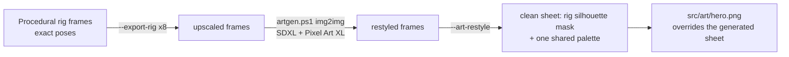

# Technical documentation
**What:** how the code is organised and how the dev tools work. **Updated:** 2026-11-21

## Code (`src/scripts/`)
| Folder | Contents |
|---|---|
| `core/` | `Game` autoload (input map, audio buses, hit-stop, shake), `InputSetup` |
| `actors/` | `Player`, `Warden`, combat types (`HitInfo`, layers, flash shader) |
| `world/` | `Main` (builds the level in code), `Hud`, `CameraRig`, `Checkpoint`, `Candles`, `Effects`, `Sfx` |
| `art/` | `PixelCanvas` (software pixel drawing), `CharacterRig` (posed side-view characters), `Animations` (poses + sheets), `EnvironmentArt`, `ArtLibrary` |
| `dev/` | `DevBridge` autoload |

Collision layers: 1 world, 2 player, 3 (value 4) enemy. Hitboxes are `Area2D`s that only detect the other side.

## DevBridge (debug builds only, 127.0.0.1:47800)
One JSON object per line, one JSON reply per line. Commands:
`ping` `status` `shot{path}` `tree{node,depth}` `get{node,prop}` `set{node,prop,value}` `call{node,method,args}`
`spawn{scene,parent,x,y}` `spawn_enemy{x,y}` `free{node}` `gd{code}` `press/release{action}` `tap{action,seconds}`
`actions` `reload` `pause{on}` `timescale{value}` `log{lines}`.

Startup script (no TCP needed): `-- --script="wait 1; press move_right; wait 1; tap attack; shot out.png; quit"`
(steps: `wait s`, `press a`, `release a`, `tap a`, `shot path`, `set node prop json`, `print text`, `quit`).
Bake art: `-- --bake-art=res://art/`.

## cot CLI (`tools/Cot`)
`.\scripts\cot.ps1 <command>` (builds on first use). Examples:
```powershell
.\scripts\cot.ps1 status
.\scripts\cot.ps1 set Player position [1500,300]
.\scripts\cot.ps1 call Player DebugDamage 6
.\scripts\cot.ps1 gd "scene.get_node('Player').Hp"
.\scripts\cot.ps1 shot reports\screenshots\now.png
```
## Art pipeline (AI-assisted, local)

| Step | Command |
|---|---|
| Install ComfyUI + models (once, ~10 GB, outside the repo) | `scripts\setup-art-tools.ps1` |
| Concept from text | `scripts\artgen.ps1 -Prompt "..." -Out reports\art\x.png -Count 4` |
| Hero sheet in the new style | `scripts\hero-restyle.ps1` |
| Clean one image to a game frame | `godot --headless --path src -- --art-clean=in.png --out=out.png --height=96` |
Why the rig stays in the loop: AI frames alone don't match from frame to frame. Using the rig's silhouette as a mask and one shared palette keeps every frame the same shape and colour.
