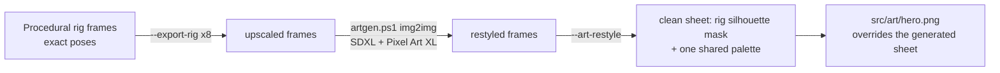

# Technical documentation
**What:** how the code is organised and how the dev tools work. **Updated:** 2026-11-21

## Code (`src/scripts/`)
| Folder | Contents |
|---|---|
| `core/` | `Game` autoload (input map, audio buses, hit-stop, shake), `InputSetup` |
| `actors/` | `Player`, `Warden`, combat types (`HitInfo`, layers, flash shader) |
| `world/` | `Main` (builds the level in code), `Hud`, `CameraRig`, `Checkpoint`, `Candles`, `Effects`, `Sfx` |
| `art/` | `PixelCanvas` (software pixel drawing), `CharacterRig` (posed side-view characters), `Animations` (poses + sheets), `EnvironmentArt`, `ArtLibrary` |
| `dev/` | `DevBridge` autoload |

Collision layers: 1 world, 2 player, 3 (value 4) enemy. Hitboxes are `Area2D`s that only detect the other side.

## DevBridge (debug builds only, 127.0.0.1:47800)
One JSON object per line, one JSON reply per line. Commands:
`ping` `status` `shot{path}` `tree{node,depth}` `get{node,prop}` `set{node,prop,value}` `call{node,method,args}`
`spawn{scene,parent,x,y}` `spawn_enemy{x,y}` `free{node}` `gd{code}` `press/release{action}` `tap{action,seconds}`
`actions` `reload` `pause{on}` `timescale{value}` `log{lines}`.

Startup script (no TCP needed): `-- --script="wait 1; press move_right; wait 1; tap attack; shot out.png; quit"`
(steps: `wait s`, `press a`, `release a`, `tap a`, `shot path`, `set node prop json`, `print text`, `quit`).
Bake art: `-- --bake-art=res://art/`.

## cot CLI (`tools/Cot`)
`.\scripts\cot.ps1 <command>` (builds on first use). Examples:
```powershell
.\scripts\cot.ps1 status
.\scripts\cot.ps1 set Player position [1500,300]
.\scripts\cot.ps1 call Player DebugDamage 6
.\scripts\cot.ps1 gd "scene.get_node('Player').Hp"
.\scripts\cot.ps1 shot reports\screenshots\now.png
```
## Art pipeline (AI-assisted, local)

| Step | Command |
|---|---|
| Install ComfyUI + models (once, ~10 GB, outside the repo) | `scripts\setup-art-tools.ps1` |
| Concept from text | `scripts\artgen.ps1 -Prompt "..." -Out reports\art\x.png -Count 4` |
| Hero sheet in the new style | `scripts\hero-restyle.ps1` |
| Clean one image to a game frame | `godot --headless --path src -- --art-clean=in.png --out=out.png --height=96` |
Why the rig stays in the loop: AI frames alone don't match from frame to frame. Using the rig's silhouette as a mask and one shared palette keeps every frame the same shape and colour.
Any character: `scripts\restyle.ps1 -Rig hero|warden|ghoul|archer|abbot [-Only anim1,anim2] [-Revert]`. Painted PNGs are merged over the generated sheet, so animations added later keep working until they are painted too.

## Scenes and flow (v0.3)
| Scene / node | Job |
|---|---|
| `scenes/Menu.tscn` → `ui/MainMenu.cs` | title screen, slots, options; main scene of the project |
| `scenes/Main.tscn` → `world/Main.cs` | builds the level, spawns actors, altar/death/boss loop |
| `Game` autoload (`core/Game.cs`) | current run (`SaveData`), `NewGame`/`Continue`/`QuitToMenu`, music, hit-stop, shake |
| `core/SaveSystem.cs` | `SaveData` (stats, ashes, items, taken ids, lit altars, remnant) + 3 JSON slots in `user://` (slot 9 = tests) |
| `core/Settings.cs` | options in `user://settings.json`, applied to window/audio buses |
| `ui/Hud.cs`, `ui/GameMenus.cs`, `ui/OptionsPanel.cs`, `ui/UiKit.cs` | HUD, pause/altar/relic/victory menus, options, shared theme |
| `actors/EnemyBase.cs` | shared enemy brain; `Enemies.cs` (Warden, Ghoul, Archer, Wisp, Arrow), `Abbot.cs` (boss, Shockwave, FirePillar) |
| `world/LevelBuilder.cs`, `world/LevelObjects.cs` | map parser, merged collision, terrain renderer; altars, chests, levers, gates, doors, breakable walls, pickups, ladders, hazards, loot |

## Level files (`src/levels/*.txt`)
`[map]`: one character per 32x32 tile (legend at the top of the file). `[meta]`: one line per object that needs details, keyed by its tile:
`altar x y Name` · `chest x y ashes:120|relic:id|key:id|item:id|flask_shard` · `item x y loot` · `lever x y gateX gateY` · `door x y key` ·
`move x y dx dy period` · `pendulum x y phase` · `firejet x y offset` · `breakable x y tiles` · `bossgate x y`.
World objects are remembered in the save by `kind_x_y` ids (opened chests, pulled levers, broken walls, picked items).

## Collision layers
1 World · 2 Player · 3 (4) Enemy · 4 (8) OneWay ledges/platforms · 5 (16) Hazard · 6 (32) Interact (altars, chests, ladders) · 7 (64) Projectile.

## Exporting a build
1. Once per PC: Godot 4.7.2 **mono** export templates in `%APPDATA%\Godot\export_templates\4.7.2.stable.mono\` (Godot editor: Editor > Manage Export Templates > Download, or unzip `Godot_v4.7.2-stable_mono_export_templates.tpz` from the official GitHub release, folder `templates/`).
2. `.\scripts\package.ps1` → `build\windows\` (exe with the game packed inside + `data_ClashOfThrones_windows_x86_64\` with the .NET runtime) and `build\ClashOfThrones-v<version>-windows.zip`.
Preset: `src/export_presets.cfg` ("Windows Desktop", x86_64, includes `levels/*.txt`). Release builds have no DevBridge. `build/` is not in git.

## DevBridge additions (v0.3)
TCP: `status` (player, run, enemies with type/state/hp), `give {loot}`, `newgame`, `spawn_enemy {x,y,kind}`. Startup script steps: `newgame`, `continue N`, `menu`, `give loot`, `tp x y`.
Test hooks: `cot call Player DebugDamage 3`, `cot call Actors/Boss DebugDamage 400`.
